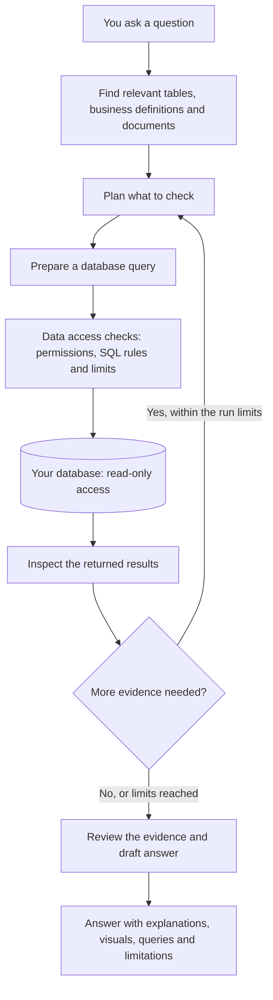

<div align="center">

# DataMind

### Ask a business question. Get a clear answer, the numbers behind it, and a way to check the work.

[Local setup](#run-datamind-locally) · [How it works](#how-datamind-works) · [Technology](#technology) · [Project docs](#project-docs)


</div>

## What is DataMind?

DataMind is a data analysis workspace for people who know their business but do not write database queries.

Connect a database, explain the business terms your team uses, and ask a question in normal English. DataMind finds the relevant data, plans an investigation, runs checked queries, and turns the results into an answer you can read and explore.

A sales total may tell you that the business grew. The useful next question is: **Did most stores improve, or did one strong store hide problems elsewhere?** DataMind can follow that question through the data, compare stores, look at changes over time, and show the evidence behind its conclusion.

The work happens inside a purpose-built analysis system: a database catalog, business definitions, a research loop, controlled data access, evidence checks, and a visual reporting interface.

## What you can do

| | What it helps you do |
| --- | --- |
| 🔎 **Investigate a change** | Start with a broad question, then look into the stores, dates, or channels that contributed to it. |
| 📊 **Read a visual answer** | See plain English alongside KPI cards, comparison tables, bar charts, and trends. Compare multiple lines on the same chart, or switch back to the source table. |
| 🧾 **Check the work** | Open the queries behind an answer, inspect the results, and see the method, limitations, and recorded model usage. |
| 📖 **Use your business language** | Define what terms such as sales, refunds, or completed orders mean for your organization. Add documents that explain the business. |
| 💬 **Keep asking** | Follow up in the same conversation: “Which stores drove that?” or “Does that still hold if we exclude cancelled orders?” |
| 👥 **Work as a team** | Keep data sources, definitions, documents, and conversations within an organization, with Admin, Contributor, and Reader roles. |

The answer format follows the question. A business review can include a summary, cards, charts, and next steps. Ask for a **short answer** when you only need the main point. Available metrics and chart detail depend on the connected data and the results returned.

### Questions worth exploring

These examples need the relevant data in your connected database:

- “Are sales growing across most stores, or are a few stores carrying the rest?”
- “Which stores are getting more orders but making less money per order?”
- “Are discounts bringing in new customers, or mostly going to people who already buy from us?”
- “Do customers come back after their first discounted order without needing another coupon?”
- “When did these two stores start performing differently?”

## How DataMind works

Before the first question, DataMind reads the database structure: tables, columns, and relationships. Column profiling adds information about the values they contain. Business definitions and uploaded documents add the meaning that table names alone cannot explain.

For each question, the API runs a bounded investigation:



**It investigates in steps.** One query may establish the overall change; another may compare stores; a third may check the daily pattern. The next step depends on what the earlier results show. The controller limits queries, model calls, time, and spending so an investigation cannot continue indefinitely.

**It checks access before running SQL.** Every customer-data query passes through the Data Access Layer (DAL). This code checks SQL against the catalog and access policy, applies query limits and timeouts, and masks protected values before results are stored or shown to the model. Database credentials are checked for read-only access. The model cannot grant itself permissions or bypass this route.

**It reviews the evidence before presenting it.** Code checks things such as whether cited queries succeeded and whether reported numbers appear in the results. A separate model review looks for unsupported assumptions, conflicting findings, and missing evidence. Some findings become visible warnings rather than blocking the answer.

**It keeps the work inspectable.** The API stores the run, query references, and progress events. The browser shows progress while the investigation runs, then renders the answer with its evidence. If the answer is incomplete, the product can show what remains unanswered.

These checks help catch mistakes; they do not guarantee that every query or business conclusion is correct. DataMind shows gaps and warnings so a polished report can still be questioned.

### Where everything runs

There are two application services:

- **`apps/web`** — the Next.js interface for chat, visual answers, evidence, and administration.
- **`apps/api`** — the FastAPI service containing the analysis engine, catalog, connectors, permissions, and data access checks. The research loop runs inside this service.

The platform's PostgreSQL database stores organizations, catalog information, definitions, conversations, runs, and events. Your connected business database stays separate and is queried through its connector. Query result files and encrypted connection credentials use local storage in development; Azure Blob Storage and Key Vault provide the deployment backends.

Relevant schema information, document excerpts, and bounded query results are sent to the configured model provider during analysis. Running the app locally does not make model processing offline.

## Technology

This is the stack implemented in the repository. The Python and web lockfiles contain the full package lists.

| Area | Technologies | What they do |
| --- | --- | --- |
| 🖥️ **Web application** | Next.js 16, React 19, TypeScript | Application pages, chat, and the interactive interface. |
| 🎨 **Design and interaction** | Tailwind CSS 4, Radix UI, Lucide, Motion, Sonner | Styling, accessible controls, icons, animation, and notifications. |
| 📈 **Reports and tables** | Apache ECharts, TanStack Table, React Markdown, remark-gfm | Charts, sortable tables, formatted answers, and switching between charts and their data. |
| 🔤 **Typography** | Inter, Source Serif 4, JetBrains Mono via Fontsource | Interface text, report text, and readable SQL. |
| ⚙️ **API and validation** | Python 3.12, FastAPI, Uvicorn, Pydantic, pydantic-settings | HTTP endpoints, typed inputs and outputs, and configuration. |
| 🗄️ **Platform storage** | PostgreSQL 16, SQLAlchemy, Alembic, asyncpg | Application records, database access, and migrations. PostgreSQL row-level security separates organization data. |
| 🔌 **Business database connectors** | PostgreSQL / asyncpg; Microsoft SQL Server / pyodbc, unixODBC, Microsoft ODBC Driver 18 | Connect to supported business databases through a common interface. |
| 🛡️ **SQL and credential protection** | SQLGlot, cryptography / Fernet, PyJWT | Parse and inspect SQL, encrypt local connection credentials, and validate sign-in tokens. |
| 🧠 **Models and retrieval** | OpenAI and Meta Model API adapters, HTTPX, pgvector, PostgreSQL text search | Configurable models by task, provider fallback, and finding relevant context. Meaning-based search uses configured OpenAI embeddings; wording-based search is available without them. |
| 📄 **Document processing** | pypdf, python-multipart | Read PDF text and receive document uploads. |
| 🔐 **Identity** | Microsoft Entra ID, MSAL; local development token issuer | Deployed sign-in and a simpler local sign-in flow. |
| ☁️ **Azure deployment** | Container Apps, Container Registry, Azure Database for PostgreSQL, Key Vault, Blob Storage, managed identities, Log Analytics, Bicep | Run the services, store images and results, protect credentials, collect logs, and define infrastructure as code. Azure SDKs provide identity, secrets, and storage access. |
| 📡 **Live progress** | Server-Sent Events (SSE) | Stream stored run events to the browser while an answer is being prepared. |
| 🧰 **Local tooling** | Docker Compose, uv, pnpm, GNU Make | Reproducible services, dependencies, and common project commands. |
| 🧪 **Testing** | pytest, pytest-asyncio, Hypothesis, pytest-cov, Vitest, Testing Library, Playwright | API, policy, isolation, component, browser, and analysis evaluations. |
| ✅ **Code and CI checks** | Ruff, Pyright, ESLint, TypeScript, GitHub Actions, Gitleaks, actionlint, ShellCheck | Formatting, static checks, secret scanning, workflow checks, and CI. |

## Run DataMind locally

The standard setup runs the web app, API, platform database, and sample database services with Docker Compose. You do not need an Azure account. You do need a model-provider API key for real answers.

### 1. Install the prerequisites

| Tool | Required version or purpose |
| --- | --- |
| Git | Clone the repository. |
| Docker with Compose v2 | Run the containers; start Docker Desktop first if you use it. |
| uv and Python 3.12 | Manage the Python environment. `uv python install 3.12` installs Python. |
| Node.js 22 and pnpm 10.30.3 | Run the web tools; pnpm is pinned in `apps/web/package.json`. |
| GNU Make and a POSIX shell | Run the commands below. On Windows, use Git Bash. |

On Windows, GNU Make can be installed from PowerShell:

```powershell
winget install ezwinports.make
```

After installation, open a new **Git Bash** window. Run the remaining commands from the repository root.

### 2. Clone and prepare configuration

```bash
git clone https://github.com/50ur48h/DataMind.git
cd DataMind
uv python install 3.12
make install
make env
make secrets.key
```

`make env` creates `.env` from `.env.example` if it does not already exist. `make secrets.key` prints a new `LOCAL_SECRETS_KEY=...` line. Copy that line into `.env`, replacing its empty entry. Keep this key: it is needed to read the connection credentials you save locally.

Edit `.env` before starting the services:

| Setting | What to enter |
| --- | --- |
| `LOCAL_SECRETS_KEY` | The generated line from the previous command. |
| `OPENAI_API_KEY` | Your provider key when using the default `LLM_PROVIDERS=openai`. Uncomment this setting. |
| `LLM_MODELS` | A JSON mapping from provider and tier (`small`, `mid`, `strong`) to model IDs available to your account. Check the starting values in `.env.example`. |
| `LLM_PRICES` | Prices for your configured models, including embeddings when enabled. Values are USD per million input/output tokens. |
| `LLM_RUN_COST_LIMIT_USD` | Your maximum model spend per question; the template sets a limit. |

Keep the template's local authentication settings: `ENV=local`, `AUTH_MODE=dev`, and `NEXT_PUBLIC_ENV=local`. No corporate sign-in setup is needed for this path.

Model access and prices depend on the provider account. If you change a model ID, update its price entry too. With a spending limit set, unpriced models are refused by default. Never commit `.env` or provider keys.

To use the **Meta Model API**, follow its configuration block in [.env.example](.env.example): set `META_API_KEY`, `LLM_PROVIDERS`, `LLM_MODELS`, and `LLM_PRICES`. Embeddings have separate settings; retrieval can use wording-based search without a working embedding configuration.

### 3. Start the services and create the demo data

```bash
make up
make db.setup
make seed
make ps
```

- `make up` builds and starts the containers.
- `make db.setup` applies migrations as the schema owner, then enables the separate, restricted `dataagent_app` login used by the API.
- `make seed` creates the generated pizza-chain dataset and its read-only database login. It rebuilds that demo dataset when rerun.
- `make ps` shows container status.

The sample includes an intentional sales decline and missing item-level sales data, so you can try both an investigation and a question the data cannot answer.

Default local addresses:

| Service | Address |
| --- | --- |
| Web app | [localhost:3000](http://localhost:3000) |
| API health | [localhost:8000/healthz](http://localhost:8000/healthz) |
| API reference | [localhost:8000/docs](http://localhost:8000/docs) |
| Platform PostgreSQL | `localhost:5432` |
| Pizza demo PostgreSQL | `localhost:6543` |
| Optional F&B import database | `localhost:6544` |

### 4. Sign in and connect the demo

1. Open [localhost:3000](http://localhost:3000). Enter a name on the local sign-in screen and continue.
2. Create an organization. Your account becomes its Admin.
3. Open **Settings → Data sources**, then **Register a database**.
4. Enter the connection details below and register it.

| Field | Value |
| --- | --- |
| Name | `Pizza demo` |
| Engine | PostgreSQL |
| Host | `seed-pizza-pg` |
| Port | `5432` |
| Database | `pizza` |
| Username | `pizza_readonly` |
| Password | The `SEED_PIZZA_READONLY_PASSWORD` value in your `.env` |

Use `seed-pizza-pg`, because the API connects from inside Docker. The host address `localhost:6543` is for tools running on your computer.

Run **Test connection**, then **Refresh catalog**, then **Profile columns**. The connection test must confirm read-only access before discovery. The catalog gives DataMind the schema; profiling adds column statistics and sample information. If several databases are registered, choose the one to use in Settings.

### 5. Ask your first question

Open a new chat and ask:

> How has revenue changed over time, and which store contributed most to the recent decline?

Watch the progress, read the answer, and open **How I worked this out** to inspect the supporting work. Try a follow-up:

> Is the decline coming from fewer orders or smaller orders?

Then try:

> Which individual menu items sold the most?

The included pizza fixture has no order-item table. DataMind should explain that missing link rather than report item sales.

### Connect your own database

The same registration flow supports PostgreSQL and Microsoft SQL Server. Supply a dedicated read-only login, test the connection, discover the catalog, and profile the columns. The database must be reachable from the API container; an external connection uses the configured TLS policy.

Add your team's metric meanings under **Settings → Definitions** and supporting documents under **Knowledge**. These help DataMind interpret your business terms without repeating them in every question.

For the optional SQL Server sample:

```bash
make up.mssql
make seed.mssql
```

For a local SQLite sample that you want to load into PostgreSQL:

```bash
make seed.fnb SQLITE=path/to/your.sqlite
```

That command imports the file into the F&B sample service; it is not a live SQLite connector. Keep private source files and derived material under the gitignored `.SampleData/` directory. See [the detailed setup guide](docs/setup.md) for import and configuration details.

## Everyday development

| Command | Purpose |
| --- | --- |
| `make help` | List available commands. |
| `make logs` / `make ps` | Read service logs / check status. |
| `make down` | Stop containers while keeping database volumes. |
| `make install` | Install Python and web dependencies. |
| `make api.dev` / `make web.dev` | Run the API / web app on the host instead of its container. Stop the corresponding container first to free its port. |
| `make lint` / `make typecheck` | Run code and type checks. |
| `make test` | Run the API and web test suites. |
| `make evals` | Run analysis evaluations with the test model by default; live evaluations need explicit configuration. |
| `make preflight` | Run broader local checks; its output lists the extra checks left to CI. |

For host development, copy [the web template](apps/web/.env.example) to `apps/web/.env.local`. Set `NEXT_PUBLIC_API_URL` to your API address and add these local sign-in settings there:

```dotenv
NEXT_PUBLIC_ENV=local
NEXT_PUBLIC_AUTH_MODE=dev
```

The host commands use ports 3000 and 8000 by default. The root `.env` supplies the API settings; Next.js needs its own `.env.local` when running outside Compose.

### Common setup fixes

| Symptom | What to check |
| --- | --- |
| A port is already in use | Change the relevant `*_PORT` in `.env`. Update host database URLs when changing database ports; update `NEXT_PUBLIC_API_URL`, `DEV_ISSUER_URL`, and `CORS_ORIGINS` when changing app ports. Docker service-to-service database ports stay at `5432`. |
| Registering a source says the secrets key is missing | Add `LOCAL_SECRETS_KEY` to `.env`, then recreate the API with the command below. |
| The API is running but questions fail | Check the provider key, model access, model IDs, prices, and API logs. A working health endpoint alone does not prove the model account is usable. |
| The demo connection fails | Use `seed-pizza-pg:5432` from the containerized API, and confirm `make seed` completed. |
| Analysis lacks context | Run the connection test, catalog refresh, and column profiling. Check that the organization has a selected source. |
| Windows shows old code after an edit | File-change events can be missed across Docker bind mounts. Follow the cache-clearing and restart guidance in [AGENTS.md](AGENTS.md). |

After changing API environment settings, **recreate** its container to load the new values:

```bash
docker compose --env-file .env -f ops/docker-compose.yml up -d api
```

A plain `restart` keeps the old container environment. Reload the browser after an API restart if local sign-in needs refreshing. Web environment changes also need the web container recreated; web dependency changes require rebuilding its image.

## Project docs

| Path | What to find there |
| --- | --- |
| [`apps/web`](apps/web) | Web application. |
| [`apps/api`](apps/api) | API, research engine, catalog, connectors, and DAL. |
| [`ops`](ops) | Local services, sample data scripts, and evaluations. |
| [`infra`](infra) | Azure Bicep templates and environment parameters. |
| [Architecture](docs/architecture.md) | Full system design and data boundaries. |
| [Setup guide](docs/setup.md) | Additional setup, import, and model configuration details. |
| [Current status](docs/plan/STATUS.md) | What is built and what is being worked on. |
| [Backlog](docs/plan/BACKLOG.md) / [Decisions](docs/plan/DECISIONS.md) | Known gaps and reasons behind design choices. |
| [Working agreement](AGENTS.md) | Development rules and platform-specific troubleshooting. |

Changes go through pull requests into protected `main`; the project owner reviews and merges them.

**License:** No license has been selected yet. All rights reserved.
